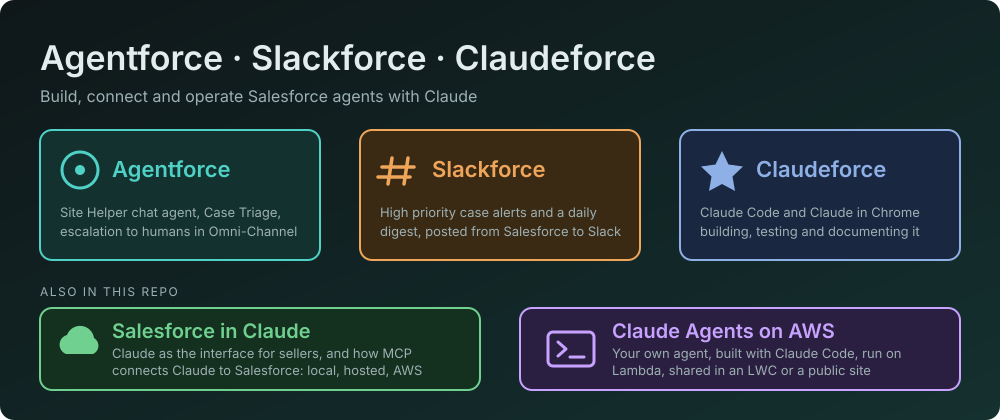
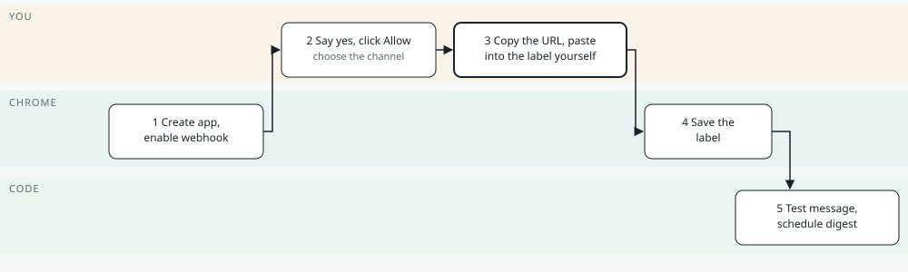
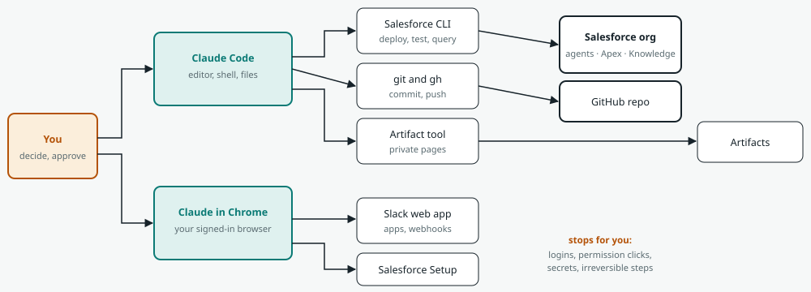

<p align="center"></p>

# Agentforce Site Helper

A working example of **Salesforce agents** for self-service and human handoff, the **Slack alerts** around them, and how **Claude** built and documented it. The code deploys with the Salesforce CLI. Source API version 68.0, tested in a Developer Edition org.

| | What it covers | Page |
|---|---|---|
| **Agentforce** | Site Helper chat agent, escalation to a human through Omni-Channel, the internal Case Triage agent, Knowledge | [docs/agentforce.html](docs/agentforce.html) |
| **Slackforce** | High priority case alerts and a daily digest posted from Salesforce to Slack, the agent-in-Slack option, setup roles | [docs/slackforce.html](docs/slackforce.html) |
| **Claudeforce** | How Claude Code and Claude in Chrome were used, where a human approved, what went wrong | [docs/claudeforce.html](docs/claudeforce.html) |

The pages are standalone HTML, starting at [docs/index.html](docs/index.html). On GitHub they show as source. Download them, or turn on GitHub Pages for the `/docs` folder to read them as web pages.

## Agentforce

A visitor chats on the site. The messaging channel hands the session to the Site Helper agent, whose router picks General Info, Follow-Up Capture, Off Topic or Escalation. Escalation transfers the chat to an Omni-Channel queue where a person accepts it.


## Slackforce

A new High priority Case, or a daily schedule, builds a short message. One class posts it to a Slack incoming webhook. Nothing is sent until you set the webhook label.




Instructions you can paste into Claude in Chrome to set up the Slack side: [docs/slackforce-chrome-instructions.md](docs/slackforce-chrome-instructions.md). Replace the placeholders for your own org URL and Slack workspace ID first.

## Claudeforce

Claude Code deployed and tested through the Salesforce CLI and pushed to GitHub. Claude in Chrome handles web-only steps. Secrets, logins and permission clicks stay with you.



## How it fits together

```
Visitor -> Site (Embedded Service chat) -> Messaging channel
        -> Agentforce Service Agent "Site_Helper"
             Agent Router -> General Info | Follow-Up Capture | Off Topic | Escalation
        Escalation -> @utils.escalate -> Omni-Channel -> Queue -> Human agent (Service Console)

Support staff -> Case Triage Assistant -> Apex actions -> Case records
Case insert (High) / daily job -> SlackCaseNotifier -> Slack webhook
```

The full write-ups, with diagrams, code listings and configuration, are the three pages in `docs/`, linked above.

## Repository layout

| Path | Contents |
|---|---|
| `force-app/main/default/classes` | Apex actions for Case Triage, Slack notifier, job, tests |
| `force-app/main/default/genAiFunctions`, `genAiPlugins` | Agent actions (with input/output schemas) and the Case Triage topic |
| `force-app/main/default/bots`, `genAiPlannerBundles` | Both agents. `Site_Helper_v4` holds the Agent Script |
| `force-app/main/default/messagingChannels`, `queues`, `queueRoutingConfigs`, `EmbeddedServiceConfig` | Chat channel, queue, routing and chat deployment, retrieved from the org as reference |
| `force-app/main/default/permissionsets` | Bot user access, Knowledge body field, guest read |
| `force-app/main/default/settings`, `objects/Knowledge__kav` | Knowledge setting and article body field |
| `force-app/main/default/triggers`, `labels`, `remoteSiteSettings` | Slack alert trigger, webhook label, remote site |
| `specs/` | Agent spec and agent test spec |
| `scripts/apex/` | Seed scripts for Knowledge articles and sample Cases |
| `docs/` | Architecture page, Slack notes, decoded Site Helper agent script |

## Before you start

- Salesforce CLI (`sf`) and an org with Agentforce enabled. Replace `<org>` below with your org alias.
- A user who can create agents and deploy metadata.
- Log in: `sf org login web --alias <org>`

### Placeholders to replace

This repo is public, so org-specific usernames were removed. Search for these and use your own values:

- `ORG_USER_USERNAME_PLACEHOLDER`: a user in your org, for example the queue member in `queues/BYOC_Messaging_Queue.queue-meta.xml`.
- `AGENT_BOT_USER_PLACEHOLDER`: the agent's bot user. Creating an agent generates this user for you, so prefer creating agents as in the steps below over deploying the `bots` folder as is.

## Steps

### 1. Deploy the Apex actions and run their tests

```
sf project deploy start -o <org> \
  -m ApexClass:CaseTriageListInvocable -m ApexClass:CaseTriageEscalateInvocable \
  -m ApexClass:CaseTriageAgentActionsTest \
  -l RunSpecifiedTests -t CaseTriageAgentActionsTest
```

Deploy only these classes. If other classes in your org lack tests, a wider deploy fails the 75% coverage check.

### 2. Create the Case Triage agent

```
sf agent create -o <org> --name "Case Triage Assistant" \
  --api-name Case_Triage_Assistant --spec specs/caseTriageAgent.yaml
```

This creates the bot, planner bundle, a topic and the agent's bot user. Note the topic API name it prints or find it in `genAiPlugins`. The topic file in this repo is named `p_16jgL000002k4kD_Case_Triage`. Yours will have a different suffix, so edit the test spec and the commands below to match.

### 3. Add the actions to the topic

Each action needs its `input/schema.json` and `output/schema.json`. Without them the action deploys but cannot be used, and the agent answers "Off Topic".

```
sf agent deactivate -o <org> --api-name Case_Triage_Assistant
sf project deploy start -o <org> \
  -m GenAiFunction:ListOpenCasesAction -m GenAiFunction:SetCasePriorityAction \
  -m GenAiPlugin:<your topic API name>
```

The topic file in `genAiPlugins` lists the two functions and the instructions. Copy those into your generated topic.

### 4. Give the agent's user access

The agent runs as its own bot user. Deploy and assign the permission set:

```
sf project deploy start -o <org> -m PermissionSet:CaseTriage_Agent_Access
sf org assign permset -o <org> -n CaseTriage_Agent_Access -b <bot user username>
```

The Einstein Agent license does not allow View All Case or Account, so the set uses read access with sharing.

### 5. Activate and test

```
sf agent activate -o <org> --api-name Case_Triage_Assistant
sf agent test create -o <org> --spec specs/caseTriageTests.yaml \
  --api-name Case_Triage_Assistant_Tests --force-overwrite
sf agent test run -o <org> -n Case_Triage_Assistant_Tests -w 10 --result-format human
```

Open it in Agentforce Builder: `sf org open agent --api-name Case_Triage_Assistant -o <org>`

### 6. Load sample data and Knowledge

```
sf apex run -o <org> -f scripts/apex/ingestCases.apex
sf project deploy start -o <org> -m Settings:Knowledge
sf project deploy start -o <org> -m CustomField:Knowledge__kav.Article_Body__c \
  -m PermissionSet:Knowledge_Article_Body_Access
sf org assign permset -o <org> -n Knowledge_Article_Body_Access
sf apex run -o <org> -f scripts/apex/createKnowledge.apex
```

Enabling Knowledge cannot be undone. Run `ingestCases.apex` and `createKnowledge.apex` once only. A second run duplicates Cases and fails on the duplicate article URL names.

### 7. Create the Site Helper agent, channel and queue

These are configured in the Salesforce UI. The files in this repo are a reference copy retrieved from a working org.

1. In Agentforce Builder, create a service agent and paste in the Agent Script from `docs/site_helper_agent_script.agent.txt`. Replace the sample company facts in the General Info subagent with your own. Activate it.
2. In Setup, create a queue for `MessagingSession` with a routing configuration, and add at least one user.
3. Create a Messaging channel of type Embedded Messaging. Set the session handler to your Agentforce service agent and the fallback queue to the queue from step 2.
4. Create an Embedded Service deployment for that channel, attach it to a published Experience site, and publish.
5. Test two chats: a normal question, and "I want to talk to a person". The second should reach the queue when someone is available in Omni-Channel.

For routing decisions before the agent (hours, language, VIP) use an Omni-Flow router instead: on the channel set the routing type to Omni-Flow and pick a flow with a Route Work action.

### 8. Turn on Slack alerts

1. In Slack, create an app, enable Incoming Webhooks, add a webhook to a channel, and copy the URL.
2. In Salesforce Setup, open Custom Labels, edit `Slack_Webhook_Url` and replace `REPLACE_ME` with the URL.
3. Deploy and test:

```
sf project deploy start -o <org> \
  -m CustomLabel:Slack_Webhook_Url -m RemoteSiteSetting:Slack_Hooks \
  -m ApexClass:SlackCaseNotifier -m ApexClass:SlackCaseDigestJob -m ApexClass:SlackCaseNotifierTest \
  -m ApexTrigger:CaseSlackAlertTrigger \
  -l RunSpecifiedTests -t SlackCaseNotifierTest
```

4. Schedule the daily digest in Execute Anonymous:

```
System.schedule('Slack case digest', '0 0 8 * * ?', new SlackCaseDigestJob());
```

While the label says `REPLACE_ME`, nothing is sent. The webhook URL is a secret. For production, store it in a Named Credential instead of a label.

## Known limits

- Site Helper answers from facts written in its script. It is not connected to the Knowledge articles.
- It collects a visitor's name and email into agent variables but does not create a Lead.
- The `bots`, `messagingChannels`, `queues` and `EmbeddedServiceConfig` files were retrieved for reference. They were not redeployed to a second org, so they may need edits (for example branding and site references) to deploy elsewhere.
- Case Triage Assistant can edit Cases. Keep it internal.

## Troubleshooting

| Symptom | Cause and fix |
|---|---|
| Agent replies "Off Topic" to every message | The action is missing `input/schema.json` or `output/schema.json`, or the bot user lacks access to the Apex classes |
| `sf agent publish` not found | Older CLI. Use `sf agent create` and metadata deploys, or update the CLI |
| Permission set will not assign to the bot user | Remove View All permissions. The Einstein Agent license rejects them |
| Deploy fails on coverage | Deploy only the classes listed, with `-l RunSpecifiedTests` |
| Slack posts nothing | `Slack_Webhook_Url` is still `REPLACE_ME`, or the remote site is inactive |

## License

No license has been chosen. Add one before reusing this code.
