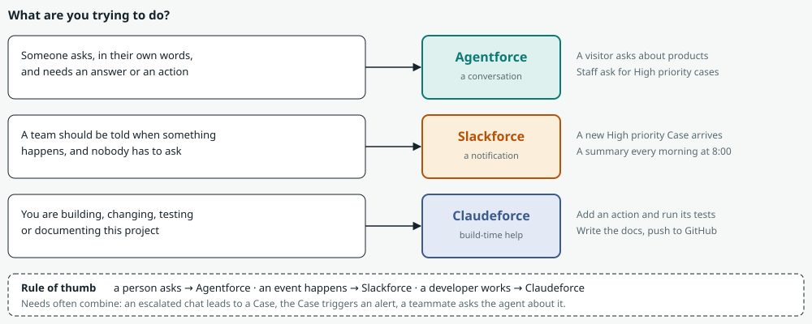
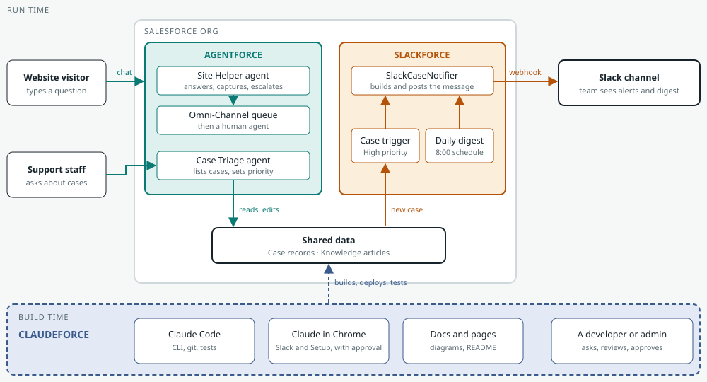
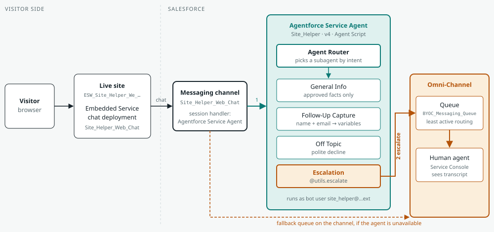
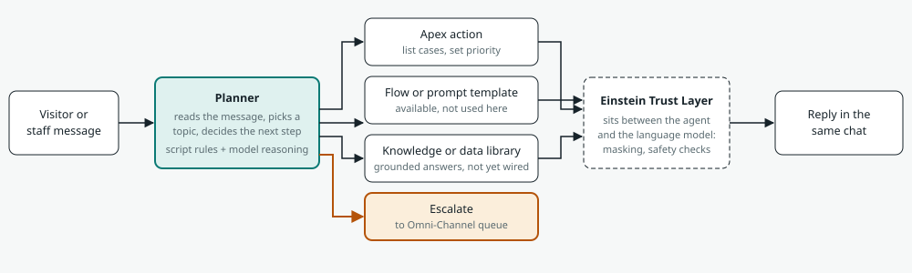
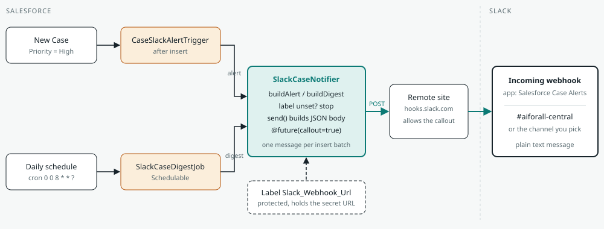

<p align="center"></p>

# Agentforce Site Helper

A working example of **Salesforce agents** for self-service and human handoff, the **Slack alerts** around them, and how **Claude** built and documented it. Source API version 68.0, tested in a Developer Edition org.

**Live site:** https://srinipusuluri.github.io/sfdc_agentforce_sitehelper/

## Which one do I use?

Start from what you are trying to do, not from the product name.



| Use | When |
|---|---|
| **Agentforce** | Someone asks in their own words and needs an answer or an action. The right response depends on what was said, and the person may need a human. |
| **Slackforce** | Something happens in Salesforce and a team should be told, with nobody asking. The message has the same shape every time. |
| **Claudeforce** | You are building, changing, testing or documenting the project. It works for the developer, not for end users. |

## How they fit together

Agentforce and Slackforce run in your Salesforce org, in front of people. Claudeforce sits underneath, at build time, and never talks to customers.



**An example flow.** A visitor chats that a generator will not start and asks for a person (Agentforce). A support agent accepts the chat and opens a High priority Case. The Case trigger posts an alert to the team channel (Slackforce). A teammate asks the Case Triage Assistant for the open High priority Cases (Agentforce). Claude built and documented all of it (Claudeforce) and plays no part in the customer conversation. Each step exists, but they have not been run together as one scenario.

## Side by side

| | Agentforce | Slackforce | Claudeforce |
|---|---|---|---|
| **In one line** | Conversational agents that understand free text and act on Salesforce data | Automatic Slack messages when something happens in Salesforce | Claude helping people build, test and document the project |
| **Who it serves** | Website visitors and support staff | The support team | The developer or admin |
| **What starts it** | Someone sends a message | A new Case, or the clock at 8:00 | A person asks Claude to do a task |
| **AI at run time** | Yes, a language model reasons about each message | No. Plain Apex, same output each time | Yes, but only while building, never in front of customers |
| **Human in the loop** | Hands over to a human through Omni-Channel | Humans read and act on the messages | A person approves secrets, logins, permission clicks and risky steps |
| **Best for** | Deflecting routine questions, answering in context | Making sure nothing urgent is missed | Repeatable build, test and documentation work |
| **Not for** | Plain notifications, fixed rules | Conversation, approvals, buttons | Secrets, production support, unreviewed production deploys |
| **Status** | Built. A live human handoff was not run by Claude | Built, proven end to end | Used throughout this repo |
| **Page** | [Agentforce](https://srinipusuluri.github.io/sfdc_agentforce_sitehelper/agentforce.html) | [Slackforce](https://srinipusuluri.github.io/sfdc_agentforce_sitehelper/slackforce.html) | [Claudeforce](https://srinipusuluri.github.io/sfdc_agentforce_sitehelper/claudeforce.html) |

**Common mix-ups**

| You want | Use | Why |
|---|---|---|
| A notification when a Case is created | Slackforce | It is an event with a fixed message. An agent adds cost and variation for no gain. |
| Visitors to get answers without waiting | Agentforce | It needs understanding of free text and a path to a person. |
| To change what the agent says or give it a new action | Claudeforce, then Agentforce | Claude edits and tests it while you build. Agentforce is what runs afterwards. |
| To use the Case Triage agent from Slack | Agentforce, reached from Slack | Needs the Salesforce and Slack integration, which is unconfirmed on a free plan. |
| A secret entered, or a permission screen approved | You | None of the three should do this for you. |

## Agentforce

Agentforce handles **conversations**. Someone types a request in their own words, and an agent decides what to do: answer, collect details, run an action on Salesforce data, or hand the person to a human.



**Use cases**

| Use case | Who | Status |
|---|---|---|
| Answer product and company questions from approved facts | Website visitor | Built |
| Request a demo or callback (name and email captured) | Website visitor | Built, not saved to a Lead yet |
| Ask for a person, escalate through Omni-Channel to a queue | Website visitor | Configured, live human handoff not run by Claude |
| Decline unrelated requests | Website visitor | Built |
| List open Cases by priority | Support staff | Built, tested |
| Change a Case priority, with confirmation | Support staff | Built, confirmation seen, update not run |
| Answer from the 5 Knowledge articles | Website visitor | Next |
| Save visitor details as a Lead | Visitor, sales | Next |
| Route by hours, language or VIP with an Omni-Flow | Website visitor | Next |
| State prices or guarantees, take payments | | Out of scope |
| Let the public edit Cases | | Out of scope |



## Slackforce

Slackforce **pushes information to people where they already work**. A rule in Salesforce fires, Apex builds a short message, and Slack shows it. No AI at run time.



**Use cases**

| Use case | Who | Status |
|---|---|---|
| Instant alert on a new High priority Case | Support team | Built, proven end to end |
| Daily digest of open Cases by priority at 8:00 | Team lead | Built, scheduled |
| Alert when a Case is escalated | Support team | Next |
| Link to the Case in each message | Support team | Next |
| Different channels by priority or product | Support team | Next |
| SLA breach warning | Team lead | Next |
| Use the Case Triage agent from Slack | Support staff | Option, unconfirmed on a free Slack plan |
| Approve or reassign from a Slack button | | Out of scope, needs a custom Slack app |
| Post customer personal data | | Out of scope |

**What was tested.** The Apex tests pass. A test message, the digest and an alert appeared in Slack. A High priority test Case fired the trigger on its own and the alert arrived. The test Case was then deleted.


## Claudeforce

Claudeforce is **Claude as the builder and operator**. It works while a person is building or maintaining the project. End users never see it and it is not in the run-time path.


**Use cases**

| Use case | Status |
|---|---|
| Build and deploy Apex with tests | Done |
| Create and wire an agent: spec, actions with schemas, topic, permissions | Done |
| Test an agent with real utterances | Done, results were mixed |
| Retrieve and document what is already in an org | Done |
| Load sample data | Done |
| Test the Slack alerts end to end | Done |
| Drive a web UI with approvals (Claude in Chrome) | Instructions written. The Slackbot page had no agent builder |
| Publish documentation and diagrams | Done |
| Review the Apex before a release | Next |
| Log in, enter secrets, click Allow | Out of scope, left to a person |
| Answer customers in production | Out of scope, that is Agentforce |

## Repository layout

| Path | Contents |
|---|---|
| `force-app/main/default/classes` | Apex actions for Case Triage, Slack notifier, job, tests |
| `force-app/main/default/genAiFunctions`, `genAiPlugins` | Agent actions with input and output schemas, and the Case Triage topic |
| `force-app/main/default/bots`, `genAiPlannerBundles` | Both agents. `Site_Helper_v4` holds the Agent Script |
| `force-app/main/default/messagingChannels`, `queues`, `queueRoutingConfigs`, `EmbeddedServiceConfig` | Chat channel, queue, routing and chat deployment, retrieved from the org as reference |
| `force-app/main/default/permissionsets` | Bot user access, Knowledge body field, guest read |
| `force-app/main/default/settings`, `objects/Knowledge__kav` | Knowledge setting and article body field |
| `force-app/main/default/triggers`, `labels`, `remoteSiteSettings` | Slack alert trigger, webhook label, remote site |
| `specs/` | Agent spec and agent test spec |
| `scripts/apex/` | Seed scripts for Knowledge articles and sample Cases |
| `docs/` | The pages, diagrams in `images/`, Slack notes, the decoded Site Helper agent script, Chrome instructions |

## Before you start

- Salesforce CLI (`sf`) and an org with Agentforce enabled. Replace `<org>` below with your org alias.
- A user who can create agents and deploy metadata. Log in with `sf org login web --alias <org>`.

**Placeholders to replace.** This repo is public, so org-specific usernames were removed.

- `ORG_USER_USERNAME_PLACEHOLDER`: a user in your org, for example the queue member in `queues/BYOC_Messaging_Queue.queue-meta.xml`.
- `AGENT_BOT_USER_PLACEHOLDER`: the agent's bot user. Creating an agent generates this user, so prefer creating agents as below over deploying the `bots` folder as is.

## Steps

### 1. Deploy the Apex actions and run their tests

```
sf project deploy start -o <org> \
  -m ApexClass:CaseTriageListInvocable -m ApexClass:CaseTriageEscalateInvocable \
  -m ApexClass:CaseTriageAgentActionsTest \
  -l RunSpecifiedTests -t CaseTriageAgentActionsTest
```

Deploy only these classes. If other classes in your org lack tests, a wider deploy fails the 75% coverage check.

### 2. Create the Case Triage agent

```
sf agent create -o <org> --name "Case Triage Assistant" \
  --api-name Case_Triage_Assistant --spec specs/caseTriageAgent.yaml
```

This creates the bot, planner bundle, a topic and the agent's bot user. The topic file in this repo is named `p_16jgL000002k4kD_Case_Triage`. Yours has a different suffix, so edit the test spec and the commands below to match.

### 3. Add the actions to the topic

Each action needs `input/schema.json` and `output/schema.json`. Without them the action deploys but cannot be used, and the agent answers "Off Topic".

```
sf agent deactivate -o <org> --api-name Case_Triage_Assistant
sf project deploy start -o <org> \
  -m GenAiFunction:ListOpenCasesAction -m GenAiFunction:SetCasePriorityAction \
  -m GenAiPlugin:<your topic API name>
```

The topic file in `genAiPlugins` lists the two functions and the instructions. Copy those into your generated topic.

### 4. Give the agent's user access

The agent runs as its own bot user.

```
sf project deploy start -o <org> -m PermissionSet:CaseTriage_Agent_Access
sf org assign permset -o <org> -n CaseTriage_Agent_Access -b <bot user username>
```

The Einstein Agent license does not allow View All Case or Account, so the set uses read access with sharing.

### 5. Activate and test

```
sf agent activate -o <org> --api-name Case_Triage_Assistant
sf agent test create -o <org> --spec specs/caseTriageTests.yaml \
  --api-name Case_Triage_Assistant_Tests --force-overwrite
sf agent test run -o <org> -n Case_Triage_Assistant_Tests -w 10 --result-format human
```

Open it in Agentforce Builder: `sf org open agent --api-name Case_Triage_Assistant -o <org>`

### 6. Load sample data and Knowledge

```
sf apex run -o <org> -f scripts/apex/ingestCases.apex
sf project deploy start -o <org> -m Settings:Knowledge
sf project deploy start -o <org> -m CustomField:Knowledge__kav.Article_Body__c \
  -m PermissionSet:Knowledge_Article_Body_Access
sf org assign permset -o <org> -n Knowledge_Article_Body_Access
sf apex run -o <org> -f scripts/apex/createKnowledge.apex
```

Enabling Knowledge cannot be undone. Run `ingestCases.apex` and `createKnowledge.apex` once only. A second run duplicates Cases and fails on the duplicate article URL names.

### 7. Create the Site Helper agent, channel and queue

These are configured in the Salesforce UI. The files in this repo are a reference copy retrieved from a working org.

1. In Agentforce Builder, create a service agent and paste in the Agent Script from `docs/site_helper_agent_script.agent.txt`. Replace the sample company facts in the General Info subagent with your own. Activate it.
2. In Setup, create a queue for `MessagingSession` with a routing configuration, and add at least one user.
3. Create a Messaging channel of type Embedded Messaging. Set the session handler to your Agentforce service agent and the fallback queue to the queue from step 2.
4. Create an Embedded Service deployment for that channel, attach it to a published Experience site, and publish.
5. Test two chats: a normal question, and "I want to talk to a person". The second should reach the queue when someone is available in Omni-Channel.

For routing decisions before the agent (hours, language, VIP) use an Omni-Flow router instead: on the channel set the routing type to Omni-Flow and pick a flow with a Route Work action.

### 8. Turn on Slack alerts

The order matters. Deploy first, then paste the webhook. A deploy after you paste it resets the label to its placeholder.

1. In Slack, create an app, enable Incoming Webhooks, add a webhook to a channel, and copy the URL.
2. Deploy the Slack code:

```
sf project deploy start -o <org> \
  -m CustomLabel:Slack_Webhook_Url -m RemoteSiteSetting:Slack_Hooks \
  -m ApexClass:SlackCaseNotifier -m ApexClass:SlackCaseDigestJob -m ApexClass:SlackCaseNotifierTest \
  -m ApexTrigger:CaseSlackAlertTrigger \
  -l RunSpecifiedTests -t SlackCaseNotifierTest
```

3. In Setup, open Custom Labels, edit `Slack_Webhook_Url`, and replace `REPLACE_ME` with the webhook URL. Paste it yourself. Do not share it in chat or commit it.
4. Protect it from later deploys by adding this line to `.forceignore`:

```
force-app/main/default/labels/CustomLabels.labels-meta.xml
```

5. Send a test message in Execute Anonymous: `SlackCaseNotifier.send('Test from Salesforce');`
6. Prove the trigger: create a Case with Priority High. One alert should appear in Slack within seconds. Delete the test Case.
7. Schedule the daily digest in Execute Anonymous:

```
System.schedule('Slack case digest', '0 0 8 * * ?', new SlackCaseDigestJob());
```

While the label says `REPLACE_ME`, nothing is sent. For production, store the webhook in a Named Credential instead of a label.

Optional: paste [docs/slackforce-chrome-instructions.md](docs/slackforce-chrome-instructions.md) into Claude in Chrome to do the Slack side with your approval at each step. Replace the placeholders for your own org URL and Slack workspace ID first.

## Known limits

- Site Helper answers from facts written in its script. It is not connected to the Knowledge articles.
- It collects a visitor's name and email into agent variables but does not create a Lead.
- A live Site Helper chat and an escalation to a human were not run by Claude.
- The `bots`, `messagingChannels`, `queues` and `EmbeddedServiceConfig` files were retrieved for reference. They were not redeployed to a second org, so they may need edits (for example branding and site references) to deploy elsewhere.
- Case Triage Assistant can edit Cases. Keep it internal.
- The alert trigger runs on every Case insert. It sends nothing unless the webhook is set and a new Case is High priority.
- A failed Slack post is not retried.

## Troubleshooting

| Symptom | Cause and fix |
|---|---|
| Agent replies "Off Topic" to every message | The action is missing `input/schema.json` or `output/schema.json`, or the bot user lacks access to the Apex classes |
| `sf agent publish` not found | Older CLI. Use `sf agent create` and metadata deploys, or update the CLI |
| Permission set will not assign to the bot user | Remove View All permissions. The Einstein Agent license rejects them |
| Deploy fails on coverage | Deploy only the classes listed, with `-l RunSpecifiedTests` |
| Slack posts nothing | `Slack_Webhook_Url` is `REPLACE_ME`, often because a deploy reset it, or the remote site is inactive |
| Trigger runs but no Slack message | Check that the send job completed under Setup, Apex Jobs, and that the Case Priority is exactly High |

## License

No license has been chosen. Add one before reusing this code.
